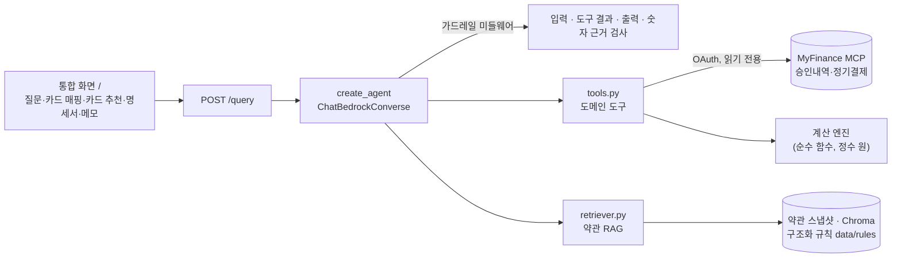

# 카드 혜택 BEP 에이전트

보유한 신용카드마다 **업종별로 얼마까지 쓰면 할인을 온전히 받는지(BEP)**, 그 뒤엔 **어느 카드로 넘어가야 하는지**를 알려주는 개인용 에이전트입니다.
카드 사용내역은 MyFinance MCP에서, 혜택 조건은 카드사 약관 원문(RAG)에서 가져오고, 모든 금액은 LLM이 아니라 순수 함수로 계산합니다.

> "10% 할인" 광고 뒤에는 전월실적 하한, 월 할인한도, 통합한도, 건당 최소금액, 횟수 제한, 실적 제외 항목이 숨어 있습니다.
> 월 한도가 4만원이면 40만원까지는 10%지만, 그 뒤 쓰는 돈의 할인율은 0%입니다. 이 지점을 카드·업종별로 계산하고 약관 원문으로 근거를 보여줍니다.

자세한 기획과 설계 결정은 [SERVICE.md](SERVICE.md), 구현 규약은 [CLAUDE.md](CLAUDE.md)에 있습니다.

---

## 무엇을 할 수 있나

| 질문 예 | 하는 일 |
|---|---|
| "10월 ROUTINE 카드 할인 얼마 받았어? 얼마까지 더 써야 해?" | 영역별 할인액·남은 한도·BEP까지 남은 사용액 계산, 약관 인용 |
| "술집에서 20만원 쓰면 어느 카드가 제일 이득이야?" | 보유 카드 전체로 결제를 시뮬레이션해 가장 유리한 카드와 합계 효과(실적 구간 변화 포함) 제시 |
| "iD ALL 결제를 SUPER로 옮기면?" | 보유 카드 간 재배분 시뮬레이션(월 전체 혜택 기준) |
| "할인받은 금액도 실적에 들어가?" | 약관 원문 검색 후 조항 인용 |
| "지난달 회고해줘" | 받은·놓친 할인, 실적 함정 거래, 채울 가치가 있는 한도만 골라 다음 달 할 일 제시 |
| 카드 추천 탭 | 카드사 홈페이지 정보로 내 소비에 맞는 카드를 빠르게 찾고, 고른 카드만 약관까지 깊게 분석(추가·교체·유지 판단) |
| 명세서 업로드 탭 | 카드사 명세서 엑셀과 계산 결과를 거래 단위로 대조해 규칙 보정 후보 제시(사람이 승인해야 반영) |

- 지원 카드사: 삼성·KB·우리(보유 카드), 하나·현대·신한·롯데(관심 카드·추천용)
- 사용자 메모(장기 기억)와 대화 맥락을 매 답변에 반영합니다.

## 구조



- **계산과 추출의 분리:** BEP·할인·실적·전환 계산은 LLM·네트워크·파일 I/O가 없는 순수 함수입니다. LLM은 약관에서 규칙을 뽑을 때와 답변을 전달할 때만 씁니다.
- **규칙의 출처:** 모든 규칙에 `source_url`, `snapshot_id`, 조항, 원문 인용이 붙습니다. 인용이 없는 값은 기본 계산 경로에서 읽지 않습니다.
- **거래 판정 순서:** 가맹점명 대조 → 업종 매핑표 → `매핑 필요`(계산에서 빼고 목록으로 표시).

### 폴더

```
src/agent.py       메인 에이전트 그래프, 가드레일·HITL 미들웨어, 서버(/query, 통합 화면)
src/tools.py       도메인 도구: MCP 조회, 거래 판정, 할인·BEP 계산, 시뮬레이션, 명세서 대조
src/retriever.py   RAG: 약관 수집·스냅샷, OCR, 청킹·임베딩, 규칙 자동 구조화, 원문 인용
data/              약관 구조화 규칙(rules/), 업종 매핑표, 평가용 카드 매핑, 시험용 명세서(statements/)
evaluation/        테스트셋(test_queries.csv), 실행기(run_eval.py), 라운드별 리포트
```

## 빠르게 실행하기

### 1. 준비물

- Python 3.12
- Amazon Bedrock 사용 권한(Claude Sonnet 4.6, Titan Embeddings v2)
- MyFinance 테스트 서버 계정: https://test.finance.zswagger.com/ (가상 데이터)

### 2. 설치

```bash
python -m venv .venv
.venv\Scripts\activate            # macOS/Linux: source .venv/bin/activate
pip install -r requirements.txt
python -m playwright install chromium   # 우리·신한카드 약관 수집용
```

### 3. 설정

```bash
cp .env.example .env
```

`.env`에서 확인할 값:

| 키 | 설명 |
|---|---|
| `SPEND_MCP_URL` | 기본값이 테스트 서버(`https://test.finance.zswagger.com/api/mcp`)입니다 |
| `AWS_REGION`, `AWS_ACCESS_KEY_ID`, `AWS_SECRET_ACCESS_KEY` | 비우면 AWS 기본 자격증명을 씁니다 |
| `BEDROCK_MODEL` | 기본 `global.anthropic.claude-sonnet-4-6`. 한도에 걸리면 다음 모델로 자동 전환합니다 |
| `SPEND_MCP_TOKEN_PATH` | 로그인 토큰 저장 위치. 저장소 밖(`~/.card-bep/`)에 둡니다 |

### 4. 서버 실행과 로그인

```bash
python src/agent.py
```

1. 브라우저에서 http://127.0.0.1:8000 을 엽니다.
2. 화면 위쪽 **MyFinance 로그인**을 눌러 테스트 서버 계정으로 로그인하고 연결을 승인합니다. 상태가 `MyFinance 연결됨 · test.finance.zswagger.com`으로 바뀌면 됩니다.
3. **카드 매핑** 탭에서 테스트 카드에 상품을 확정합니다. 상품을 고르면 약관을 받아 자동으로 구조화합니다(사람 승인 후 진행).

| 테스트 카드 | 상품 |
|---|---|
| KB:9005 | KB 쿠팡 와우 카드 |
| SAMSUNG:9002 | 삼성 iD ALL 카드 |
| WOORI:9003 | 우리 카드의정석2 ROUTINE |

4. **질문** 탭에서 물어봅니다. 예) "10월 ROUTINE 카드 영역별 남은 한도 알려줘"

### 5. 명세서 대조 시험

[data/statements/](data/statements/)에 테스트 서버 거래로 만든 **가짜 명세서** 6개(KB·삼성·우리, 9월·10월)가 있습니다. 실제 카드사 양식과 같고, 보정 흐름을 시험할 수 있게 카드마다 1~2건을 일부러 틀리게 넣었습니다.
**명세서 업로드** 탭에 6개를 한 번에 올리면 다음이 나와야 합니다.

| 명세서 | 기대 결과 |
|---|---|
| 삼성 | 할인율 차이 후보 1건, 조건 누락 후보 1건 (나머지 일치) |
| 우리 | 매핑 누락 후보 1건, 조건 누락 후보 1건 (나머지 일치) |
| KB | 명세서에 혜택 열이 없어 거래만 대조, MCP에 없는 거래 1건 |

후보를 승인하면 매핑 누락은 기본 계산에, 그 밖의 보정은 참고 계산 오버레이에 반영되고, 나머지는 "사람 확인 필요" 목록에 약관 조항과 함께 남습니다.

## API

`POST /query`로 질문을 받고 `answer`, `contexts`, `trace` 세 키로 답합니다.

```bash
curl -X POST http://127.0.0.1:8000/query \
  -H "Content-Type: application/json" \
  -d '{"question": "10월 쿠팡 와우 카드 할인 얼마 받았어?"}'
```

```json
{
  "answer": "10월 쿠팡 와우 카드 예상 할인은 ...",
  "contexts": [
    {"text": "약관 인용문", "product_name": "쿠팡 와우 카드", "product_code": "09292",
     "page": 2, "source_url": "https://...", "snapshot_id": "8ff0fe99db73", "line": "..."}
  ],
  "trace": [
    {"tool": "analyze_card_benefits", "args": {"card_key": "KB:9005", "month": "2026-10"}},
    {"analysis": {"card_key": "KB:9005", "total_discount": 0, "defaults_applied": []},
     "매핑 필요": [], "tier": "..."},
    {"guardrail": {}},
    {"trace_id": "..."}
  ]
}
```

- 요청의 `session`(선택)을 주면 같은 세션의 앞선 대화를 맥락으로 씁니다.
- `contexts`: 답에 쓴 약관 원문 인용(인용문, 상품, 쪽, 출처 URL, 스냅샷 ID, 영역)
- `trace`: 호출한 도구와 인자, 계산 요약(기본값 적용 여부 포함), `매핑 필요`로 빠진 거래·카드, 가드레일 작동 내역, 실행 기록 ID

## 평가

```bash
python evaluation/run_eval.py --round 2 --changes "이번 라운드 전에 고친 것"
```

- 테스트셋 [evaluation/test_queries.csv](evaluation/test_queries.csv): 91문항(가드레일, 도구 선택, 약관 사실, 없음 응답, 매핑 필요, 도구 결과 주입, 할인·BEP 계산, 계산 답변, 결제 시뮬레이션, 교체 후보)
- 판정 3층: 유형별 규칙 판정 → LLM-as-Judge(고정 심사 모델·루브릭, 근거 = 약관 인용 + 도구 결과) → RAGAS 정의 기반 지표
- `bep_calc`(계산 정확도)는 MCP와 LLM 없이 `data/` 픽스처만으로 돕니다.

**Round 1 결과** ([리포트](evaluation/round1_report.md))

| 항목 | 결과 | 합격선 |
|---|---|---|
| 안전 (가드레일, 도구 결과 주입) | 11/11 | 100% |
| 기능 | 40/40 | 90% 이상 |
| 할인·BEP 계산 (원 단위) | 29/29 | 100% |
| 할인·BEP 답변 | 8/9 | 90% 이상 |
| 규칙 출처 대조 (인용문이 약관 원문에 있음) | 203/203 | 100% |
| 핵심 필드 추출 (정답표 대비) | 3/3 | 100% |
| RAGAS Faithfulness / Context Recall | 0.90 / 1.00 | — |

## 보안과 개인정보

- `.env`, 로그인 토큰, 실제 거래·명세서 데이터는 저장소에 넣지 않습니다. 토큰은 저장소 밖(`~/.card-bep/`)에 있고, 로그와 응답에 남기지 않습니다.
- 의료 가맹점명(병원·의원·치과·약국 등)은 받는 즉시 `병원진료`로 바꿉니다.
- MCP에서 받은 가맹점명·메모는 신뢰할 수 없는 데이터로 다루고, 도구 결과에 섞인 지시문은 가드레일이 제거합니다.
- 숫자 근거 검사: 답변의 금액이 도구 결과나 약관에 없으면 한 번 다시 쓰게 합니다.
- 카드사 홈페이지의 robots.txt와 자동화 차단을 따릅니다(삼성 카탈로그 제외, 롯데는 PDF 직접 올리기).

## 범위 밖 (v1)

연회비 손익분기, 업종별 월간 배분 최적화, 미보유 카드 발급 권유, 다중 사용자. 확장 방향은 [SERVICE.md §6](SERVICE.md#6-확장-관점)에 있습니다.
